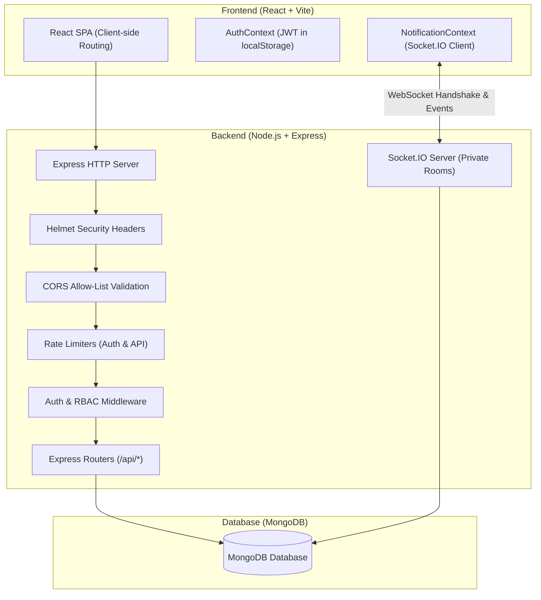

# DevFlow — Hiring & Assessment Platform

DevFlow is a full-stack recruitment, technical assessment, and interview scheduling platform. It connects candidates, recruiters, and platform administrators through a clean, role-based workflow with real-time notifications.

---

## Features by Role

### Candidate
- **Job Discovery**: Search open jobs by keyword, filter by employment type and location, and view comprehensive job specifications.
- **Application Tracking**: Submit applications with a cover letter and external resume link. Track application status (`applied`, `shortlisted`, `rejected`, `hired`) with a chronological status history audit trail.
- **Skill Assessments**: Take timed assessments (MCQ and coding questions), track time remaining with a synchronized countdown timer, and review scores and recruiter feedback.
- **Interview Scheduling**: View proposed interview slots, select and confirm preferred times, or decline with immediate status synchronization.
- **Real-Time Alerts**: Receive live notifications for application updates, graded assessments, and interview proposals.

### Recruiter
- **Company Management**: Set up and manage company profile information, branding, and contact details.
- **Job Pipeline**: Create, edit, and close job postings with detailed requirements, salary ranges, and application deadlines.
- **Applicant Review**: Review incoming candidate applications, inspect resumes, and update applicant statuses through a structured pipeline.
- **Custom Assessments**: Build job-specific assessments with timed durations, custom points, and mixed question types (multiple choice and code questions). Review submissions and grade free-form code answers.
- **Interview Coordination**: Propose multiple interview time slots (with conflict detection and timezone resolution), view candidate selections, and manage confirmed meetings.
- **Real-Time Alerts**: Receive immediate notifications when candidates submit applications, complete assessments, or respond to interview invitations.

### Administrator
- **Platform Analytics**: High-level platform health metrics across active/inactive users, job postings, applications, assessments, and interviews.
- **User Governance**: Browse and filter registered users, activate/deactivate accounts, and adjust user roles with safeguards against self-demotion and last-admin removal.
- **Job Oversight**: Review all platform job postings across companies, close stale jobs, and delete postings.

---

## Tech Stack

- **Frontend**: React 18, Vite, React Router v6, Axios, Socket.IO Client.
- **Backend**: Node.js, Express.js.
- **Database & ODM**: MongoDB, Mongoose.
- **Authentication**: JSON Web Tokens (JWT), bcryptjs.
- **Real-Time Communication**: Socket.IO (WebSockets).
- **Security & Validation**: Helmet, express-rate-limit, express-validator.

---

## Architecture Overview



---

## Folder Structure

```text
devflow-platform/
├── backend/
│   ├── config/              # Database connection, CORS, and environment validation
│   ├── controllers/         # Request handling and business logic
│   ├── middleware/          # JWT auth, RBAC, validators, rate limiters, error handling
│   ├── models/              # Mongoose data schemas (User, Company, Job, Application, Assessment, Attempt, Interview, Notification)
│   ├── routes/              # Express route declarations (/api/*)
│   ├── scripts/             # Admin seeding and database migration scripts
│   ├── services/            # Background notification dispatcher
│   ├── socket.js            # Socket.IO connection and private room management
│   ├── server.js            # Express application boot, proxy, and graceful shutdown
│   ├── .env.example         # Backend environment variable template
│   └── package.json
├── frontend/
│   ├── public/              # Static assets and favicon
│   ├── src/
│   │   ├── api/             # Axios HTTP client with cold-start retry interceptors
│   │   ├── components/      # Reusable UI components, modals, and navigation
│   │   ├── context/         # AuthContext and NotificationContext providers
│   │   ├── hooks/           # Custom React hooks (debounce, timers)
│   │   ├── pages/           # Role-based page views (Candidate, Recruiter, Admin)
│   │   ├── routes/          # Central React Router declarations and ProtectedRoute
│   │   ├── services/        # Waking state event bus
│   │   ├── socket/          # Socket.IO client factory
│   │   ├── utils/           # Formatters, URL validation, and date handlers
│   │   ├── App.jsx          # Application root with ErrorBoundary and waking banner
│   │   ├── index.css        # Design tokens and styling
│   │   └── main.jsx
│   ├── .env.example         # Frontend environment variable template
│   ├── vercel.json          # Single-page application routing rewrites
│   └── package.json
├── docs/
│   └── screenshots/         # UI walkthrough screenshots (.gitkeep)
├── LEARNING.md              # Detailed concept logs for each development phase
└── README.md                # Project documentation
```

---

## Local Development Setup

### Prerequisites
- Node.js `>=22.17.0`
- MongoDB running locally (`mongodb://localhost:27017`) or a MongoDB Atlas URI

### 1. Backend Setup
1. Open a terminal and navigate to `backend/`:
   ```bash
   cd backend
   ```
2. Install dependencies:
   ```bash
   npm install
   ```
3. Create your `.env` configuration file:
   ```bash
   cp .env.example .env
   ```
4. Configure variables in `backend/.env`:
   ```env
   PORT=5000
   NODE_ENV=development
   MONGO_URI=mongodb://localhost:27017/devflow
   JWT_SECRET=a_long_random_secret_with_at_least_32_characters
   JWT_EXPIRES_IN=7d
   CLIENT_URL=http://localhost:5173
   ADMIN_EMAIL=admin@devflow.com
   ADMIN_PASSWORD=SuperSecurePassword123!
   ```
5. Seed the initial Administrator account:
   ```bash
   npm run seed:admin
   ```
6. Start the backend development server:
   ```bash
   npm run dev
   ```

### 2. Frontend Setup
1. Open a separate terminal and navigate to `frontend/`:
   ```bash
   cd frontend
   ```
2. Install dependencies:
   ```bash
   npm install
   ```
3. Create your `.env` configuration file:
   ```bash
   cp .env.example .env
   ```
4. Verify variables in `frontend/.env`:
   ```env
   VITE_API_URL=http://localhost:5000/api
   VITE_SOCKET_URL=http://localhost:5000
   ```
5. Start the frontend development server:
   ```bash
   npm run dev
   ```
6. Open your browser at `http://localhost:5173`.

---

## Environment Variables Reference

### Backend (`backend/.env`)

| Variable | Description | Example / Default |
| :--- | :--- | :--- |
| `PORT` | HTTP server port | `5000` |
| `NODE_ENV` | Application environment (`development`, `production`, `test`) | `development` |
| `MONGO_URI` | MongoDB connection URI | `mongodb://localhost:27017/devflow` |
| `JWT_SECRET` | Secret key used to sign and verify JSON Web Tokens ($\ge 32$ chars in production) | `replace_with_a_long_random_secret...` |
| `JWT_EXPIRES_IN` | Token validity duration | `7d` |
| `CLIENT_URL` | Comma-separated allow-list of frontend origins for CORS and Socket.IO | `http://localhost:5173` |
| `RATE_LIMIT_MAX_GENERAL` | Max requests per 15-minute window for `/api/*` | `600` |
| `RATE_LIMIT_MAX_AUTH` | Max requests per 15-minute window for auth endpoints | `10` |
| `DISABLE_RATE_LIMIT` | Optional toggle to disable rate limiters in automated test suites | `false` |
| `ADMIN_EMAIL` | Administrator email used for `npm run seed:admin` | `admin@devflow.com` |
| `ADMIN_PASSWORD` | Administrator password used for `npm run seed:admin` ($\ge 12$ chars in production) | `replace_with_a_strong_password` |

### Frontend (`frontend/.env`)

| Variable | Description | Example / Default |
| :--- | :--- | :--- |
| `VITE_API_URL` | Base URL for the Express REST API | `http://localhost:5000/api` |
| `VITE_SOCKET_URL` | Root URL for the Socket.IO WebSocket server | `http://localhost:5000` |

---

## Security Decisions

1. **Stateless JWT Authentication**:
   - Bearer tokens contain minimal claims (`{ id, role }`) and are verified on each protected request.
   - User account status (`isActive`) is validated against fresh database records on every request. Deactivated accounts are immediately blocked with HTTP 403.
2. **Role-Based Access Control (RBAC)**:
   - Route-level middleware (`authorizeRoles`) enforces authorization checks across candidate, recruiter, and admin domains.
   - Frontend route guards (`ProtectedRoute`) enforce client-side navigation restrictions.
3. **Database-Enforced Ownership**:
   - Recruiters can only modify or close job postings and company profiles associated with their own user ID.
   - Candidates can only inspect their own applications and assessment attempts.
   - Resource operations cross-check ownership at the database query level (`{ _id: id, postedBy: req.user._id }`).
4. **Server-Side Scoring & Timing**:
   - Assessment question answers and correct options are never sent to candidates before submission.
   - Attempt completion times and scoring are evaluated and computed strictly on the backend.
5. **CORS Allow-List**:
   - Origins are parsed from a comma-separated list, sanitized (spaces and trailing slashes stripped), and matched explicitly without wildcards. Requests without an `Origin` header (CLI, curl) are permitted.
6. **Rate Limiting**:
   - `express-rate-limit` enforces strict thresholds on `POST /api/auth/login` (counting only failed attempts with `skipSuccessfulRequests: true`) and `POST /api/auth/register` to prevent credential stuffing and brute-force attacks.
7. **HTTP Security Headers & Payload Controls**:
   - `helmet` sets defensive HTTP headers for all responses.
   - JSON request bodies are capped at `100kb` with structured 413 and 400 error handling.

---

## Main API Routes

| Method | Endpoint | Access | Description |
| :--- | :--- | :--- | :--- |
| `GET` | `/api/health` | Public | Liveness and database connectivity health probe |
| `POST` | `/api/auth/register` | Public | Register new candidate or recruiter account |
| `POST` | `/api/auth/login` | Public | Authenticate user and issue JWT |
| `GET` | `/api/auth/me` | Authenticated | Retrieve current user profile and role |
| `GET` | `/api/jobs` | Authenticated | Browse open jobs with keyword, location, and type filters |
| `POST` | `/api/jobs` | Recruiter | Create a new job posting |
| `PATCH` | `/api/jobs/:id/close` | Recruiter / Admin | Close an open job posting |
| `POST` | `/api/applications` | Candidate | Submit a job application |
| `GET` | `/api/applications/my` | Candidate | List current candidate applications |
| `PATCH` | `/api/applications/:id/status` | Recruiter | Update application pipeline status |
| `GET` | `/api/assessments/job/:jobId` | Candidate / Recruiter | Retrieve assessment metadata or management view |
| `POST` | `/api/attempts/start` | Candidate | Start a timed assessment attempt |
| `POST` | `/api/attempts/:id/submit` | Candidate | Submit answers for auto-grading |
| `GET` | `/api/interviews/my` | Candidate | List candidate interview proposals and confirmed slots |
| `POST` | `/api/interviews` | Recruiter | Propose interview time slots to shortlisted applicant |
| `PATCH` | `/api/interviews/:id/confirm` | Candidate | Select and confirm an interview slot |
| `GET` | `/api/admin/stats` | Admin | Retrieve platform-wide metrics and status aggregations |
| `GET` | `/api/admin/users` | Admin | Search and filter registered platform users |
| `PATCH` | `/api/admin/users/:id/status` | Admin | Activate or deactivate user accounts |
| `GET` | `/api/notifications` | Candidate / Recruiter | Paginated notification list with unread filtering |

---

## Known Limitations

- **Free-Tier Hosting Cold Starts**: When hosted on free cloud tiers (such as Render), instances spin down after inactivity. The first request may take up to a minute to respond; the frontend includes a waking banner with automatic retry for GET requests.
- **JWT Expiry on Long-Lived Sockets**: Socket.IO connections authenticate on handshake. If a token expires while an active connection remains open, the socket remains connected until disconnected or refreshed.
- **No Isolated Code Execution Sandbox**: Technical assessment coding questions are accepted as formatted text and graded by recruiters; DevFlow does not run arbitrary untrusted code in a sandboxed runtime.
- **Manual Grading of Code Submissions**: While multiple-choice questions are scored automatically upon submission, free-text and code response questions require manual score input by recruiters.
- **Upstream Dependency Advisories**: Dev server and router advisories in `vite` and `react-router-dom` v6 require breaking major upgrades to Vite 8 and React Router 7; client-side redirects in DevFlow use strictly validated internal state and never accept external or unvalidated user URLs.

---

## Live Demo & Screenshots

- **Live Demo**: `[Deployment link placeholder — to be updated upon cloud provisioning]`
- **Screenshots**: UI walk-through screenshots will be stored in `docs/screenshots/`:
  - `docs/screenshots/candidate-job-board.png`
  - `docs/screenshots/candidate-assessment.png`
  - `docs/screenshots/recruiter-pipeline.png`
  - `docs/screenshots/recruiter-interview-scheduling.png`
  - `docs/screenshots/admin-dashboard.png`
